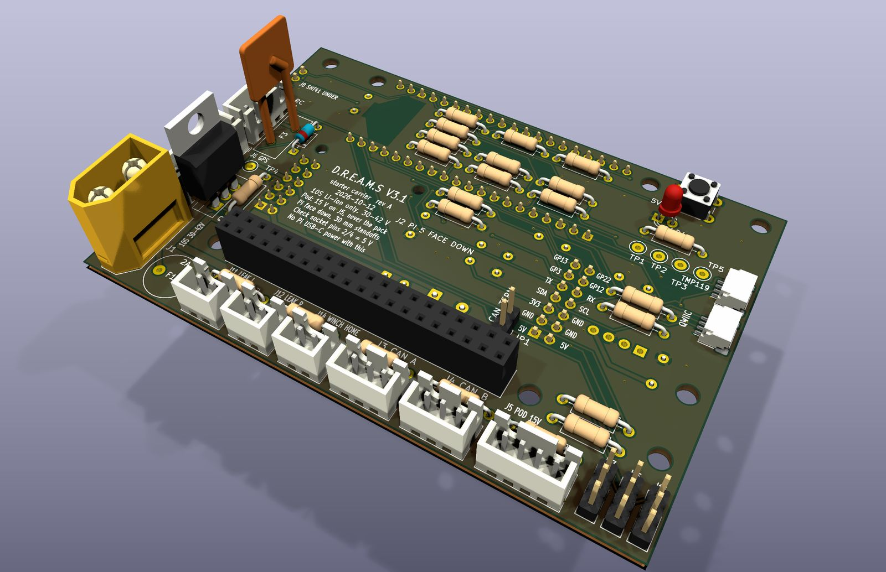
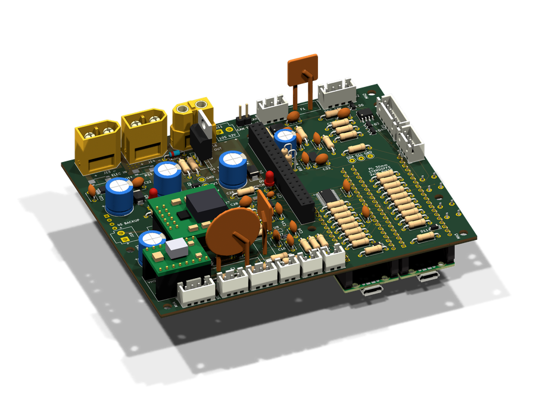
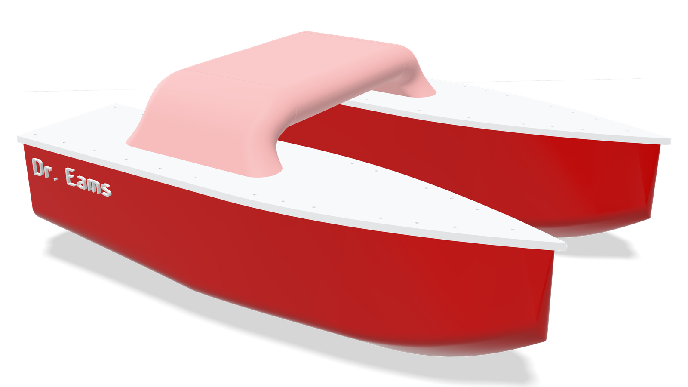
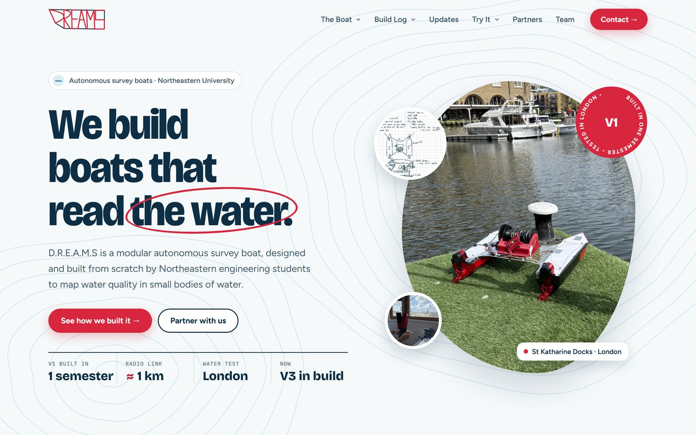
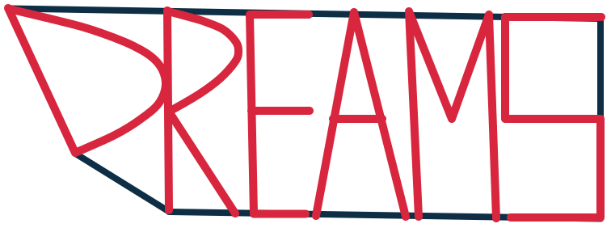
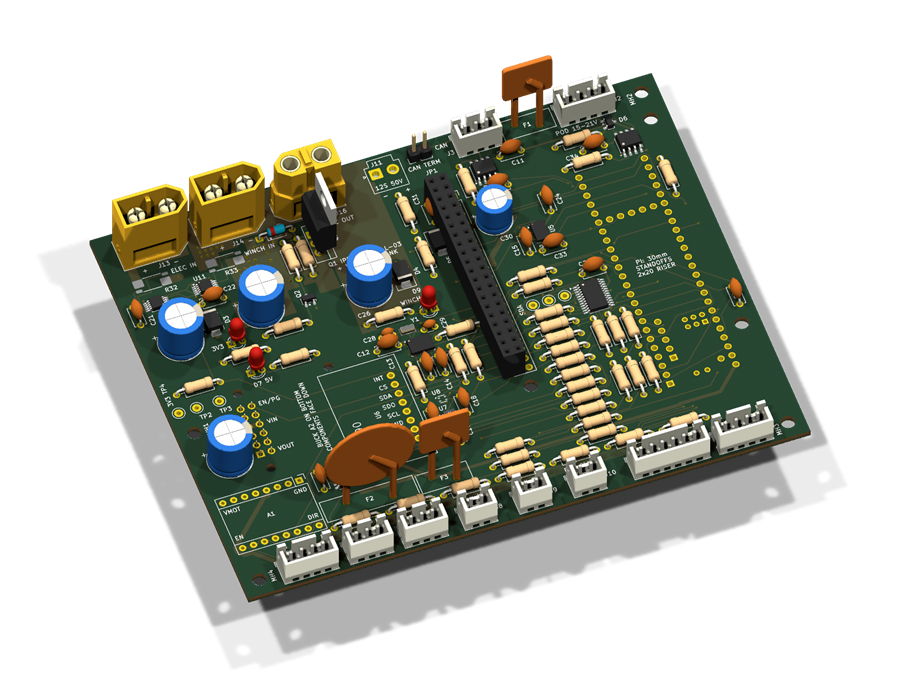
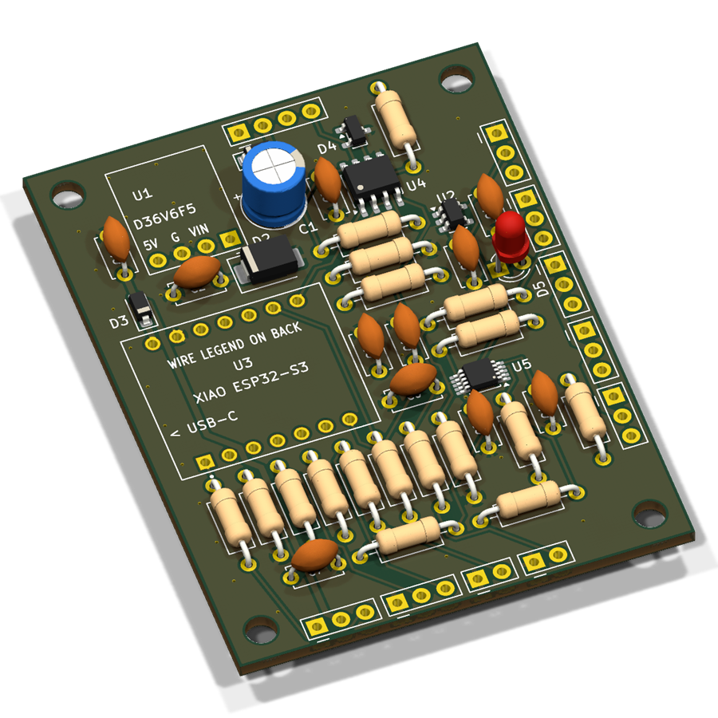

# Weekly updates

<!--
HOW WEEKLY UPDATES WORK (anyone on the team, or a Claude Code session)
- A week runs Saturday to Friday. It comes out on its Friday at 5 pm Boston time, and the site doesn't show it
  before then, so add to it all week. To see how it will look early, add ?preview to the Updates page's URL.
- Newest week at the TOP, right under this comment, headed "## Week ending <Mon> <day>, <year>" with that
  week's Friday, for example "## Week ending Oct 23, 2026".
- Under the heading, in this order:
  1. One paragraph that sums the week up: a few true, specific sentences. The Updates page shows only this
     paragraph and the photos; clicking the week opens everything.
  2. One to three photos, one per line: 
  3. One bullet per thing you worked on, starting with your name in bold: - **Kyle:** what you did
     Credit everyone who did it (- **Kyle and Matthew:** ...). Team news, like someone joining, starts with - **Team:**
- A longer story is optional: updates/<the Friday>.md, for example updates/2026-10-23.md, written as
    # A headline for the week
    ## Sections, with text and photos
  It shows on the week's page under the bullets. Photos on lines next to each other sit side by side.
- Photos: put them in img/ with their location data removed (phones often save GPS). tools/build_images.py does that.
- On GitHub: open this file, click the pencil icon, edit, then "Commit changes".
-->

## Week ending Oct 23, 2026

We ran the first CFD on the V3 hull: at 2.5 knots the catamaran needs about 13 N of thrust, and at 3.5 knots about 36 N as its bow wave builds, close to what our sizing model predicted. We also tidied up the website, which now says up front that D.R.E.A.M.S was founded by students at Northeastern University.

- **Kyle:** Ran CFD on the V3 catamaran in SolidWorks Flow Simulation at 1, 2.5 and 3.5 knots with the hulls trimmed 2.5° stern-down: about 13 N of drag at 2.5 knots and 36 N at 3.5 knots, within about 20% of the sizing model, so the drive has plenty of headroom.
- **Kyle:** Put "Founded by students at Northeastern University" on the home page, set Logan's major to Business Administration and Psychology, and corrected how the site describes where V1 was built.

## Week ending Oct 16, 2026

PCBWay started sponsoring our circuit boards. We designed V3.1, a smaller starter board that pairs the Raspberry Pi 5 with a Pico 2 to get the boat on the water sooner, then moved the full V3 board to two Pico 2s and two 10S battery packs and shrank it to 122.1 × 95.5 mm. We also picked the drive motors, put the V3 boat's SolidWorks model on the Boat page in 3D, and Logan Chen joined the team to run our marketing.

- **Kyle:** Got PCBWay to sponsor our circuit boards.
- **Logan:** Made the project's Instagram: [@dreams.boat.project](https://www.instagram.com/dreams.boat.project/).
- **Kyle:** Designed a new PCB, V3.1, to get the boat on the water before the full V3 board and to try out the Pico-based electronics planned for it. It pairs the Raspberry Pi 5 with a Raspberry Pi Pico 2 in place of the Teensy, runs from one 10S Li-ion pack, and has CAN for the motor controllers, RC control, GPS and hull leak sensors. Then moved the full V3 board to two Pico 2s as well: one runs the motors, winch and RC, the other the sensors, GPS and the pod link. They talk to the Pi over its GPIO pins, so its USB ports stay free for cameras. All three boards now share one KiCad parts library, and each board's layout rules are written up beside it. The full V3 board now runs from two 10S Li-ion packs as well, with an optional small backup battery that keeps the computers on if the main packs go off. Then dropped its barometer (the sonar gives depth) and shrank it to 122.1 × 95.5 mm, with every cable connector on an edge.
- **Kyle:** Gave every week on the website's Updates page its own page, with the full story and photos. Then made each week one paragraph with a few photos that opens the full week, and weeks now come out on Fridays.
- **Kyle:** Picked the drive motors: two Flipsky 5048 200 KV sensored outrunners, each on a Flipsky VESC-based controller that talks to the boat's board over CAN.
- **Team:** Logan Chen joined to run our marketing.
- **Matthew:** Put the V3 boat's SolidWorks model on the Boat page in 3D: spin it, take it apart and slice through the hulls and bridge.

## Week ending Oct 9, 2026

We launched this website, with the boat, a build log of every version and the V3 board in 3D, and Nolan drew our new logo by hand. Nolan Ting and Caleb Kong joined the team. We also sized V3's drive at about 200–300 W per side and started reaching out to sponsors.

- **Kyle:** Launched the D.R.E.A.M.S website with a build log.
- **Nolan:** Drew the new D.R.E.A.M.S logo.
- **Team:** Nolan Ting and Caleb Kong joined.
- **Matthew and Kyle:** Sized V3's drive at about 200–300 W per side, with belt-driven motors on deck.
- **Kyle and Matthew:** Started reaching out to sponsors.

## Week ending Oct 2, 2026

We finished rev D of the V3 carrier board, 130.6 × 101.5 mm with 4 layers and 126 parts, with its design-rule and schematic checks all passing. We also updated the sensor-pod board to rev B after a design review.

- **Kyle:** Finished the V3 carrier board, rev D: 130.6 × 101.5 mm, 4 layers, 126 parts, with design-rule and schematic checks all passing.
- **Kyle:** Updated the sensor-pod board to rev B after a design review.
