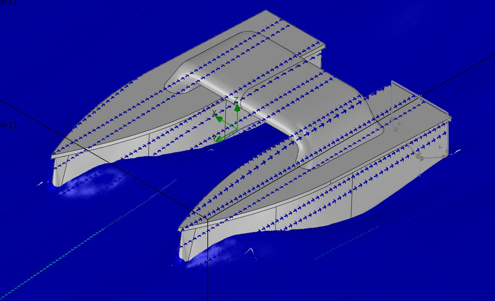
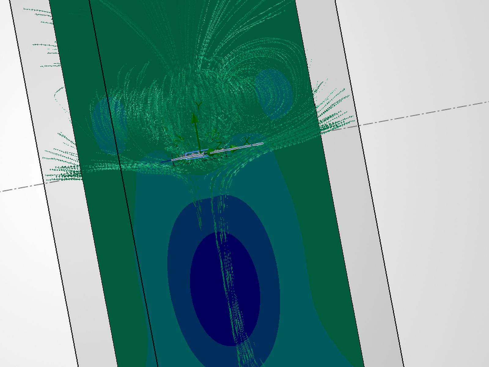
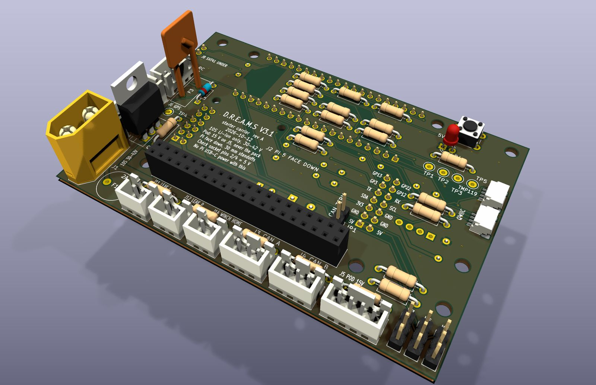
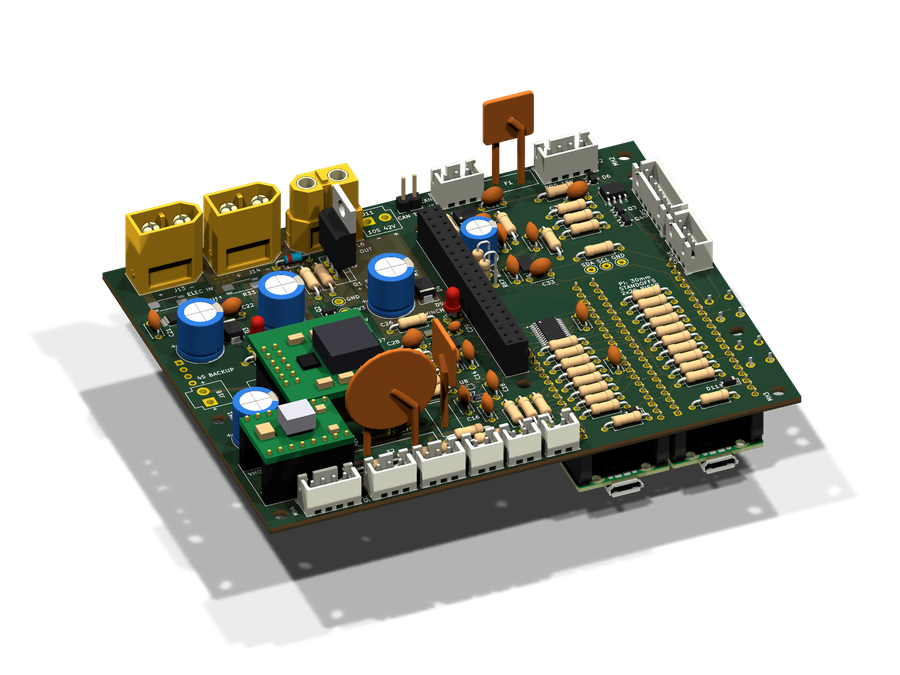
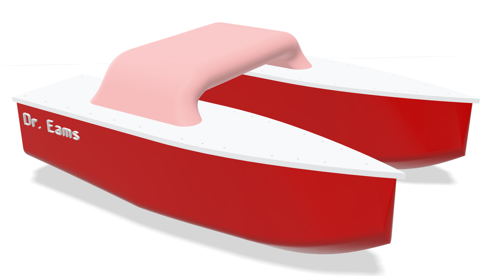
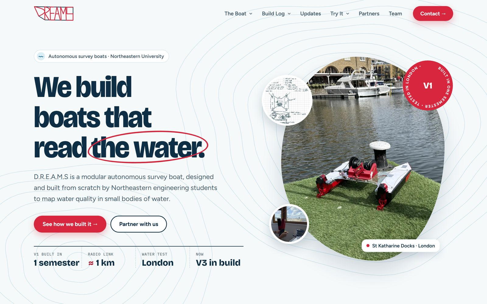
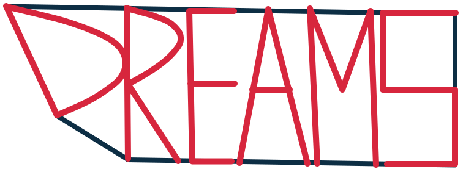
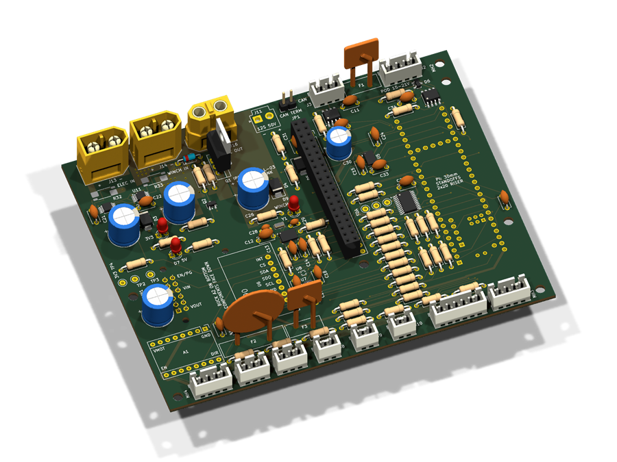
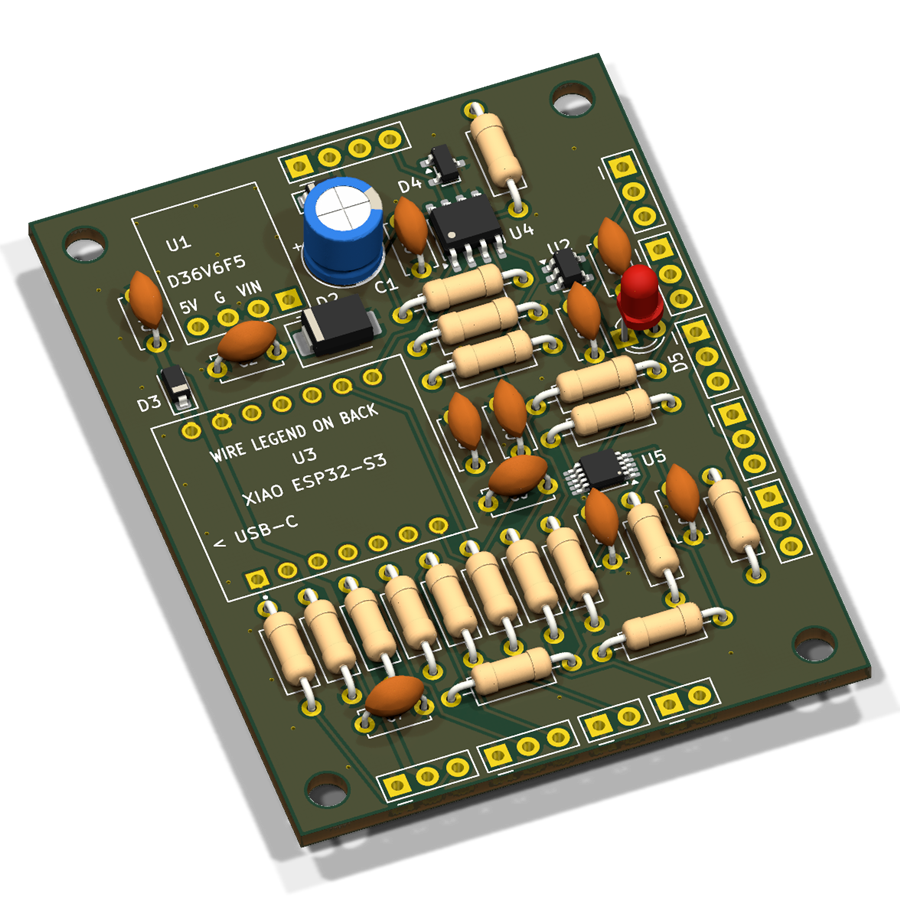

# Weekly updates

<!--
HOW WEEKLY UPDATES WORK (anyone on the team, or a Claude Code session)
- A week runs Saturday to Friday. It comes out on its Friday at 5 pm Boston time, and the site doesn't show it
  before then, so add to it all week. To see how it will look early, add ?preview to the Updates page's URL.
- Newest week at the TOP, right under this comment, headed "## Week ending <Mon> <day>, <year>" with that
  week's Friday, for example "## Week ending Oct 23, 2026".
- Write for someone outside the team, like a sponsor or a partner who has never seen the boat: plain words,
  short sentences, numbers with units, and every technical term explained the first time (CFD, toroidal).
- Under the heading, in this order:
  1. One paragraph that sums the week up: a few true, specific sentences. The Updates page shows only this
     paragraph and the photos; clicking the week opens everything.
  2. One to three photos, one per line: 
  3. One bullet per thing we worked on, written for the team with no name in front:
     - Ran computer flow simulations (CFD) of the hull at three speeds.
     Name people in the sentence only when it matters who did it: - Nolan drew the new logo.
- A longer story is optional: updates/<the Friday>.md, for example updates/2026-10-23.md, written as
    # A headline for the week
    ## Sections, with text and photos
  It shows on the week's page under the bullets. Photos on lines next to each other sit side by side.
- Photos: put them in img/ with their location data removed (phones often save GPS). tools/build_images.py does that.
- On GitHub: open this file, click the pencil icon, edit, then "Commit changes".
-->

## Week ending Nov 6, 2026

We got our starter circuit board (V3.1) closer to ordering. Its four mounting holes for the Raspberry Pi 5 computer now match the Pi's own 2.7 mm holes, and we worked out how tall the Pi's supports and socket need to be to clear its cooler and plugs.

- Matched the starter board's and the full board's Raspberry Pi mounting holes to the Pi 5's 2.7 mm holes (they were 3.2 mm), and worked out the support (standoff) and socket heights: the Pi hangs face down 30 mm above the board, so its socket has to stand about 27.5 mm tall.

## Week ending Oct 30, 2026

This week went into the propellers. In nearly 50 computer flow simulations (CFD), we improved one propeller design a step at a time and cut the power it needs at our 2.5-knot cruising speed from about 47 W to about 26 W. Caleb, Kyle and Nolan started designing the propulsion system, and we settled the boat's width at 733 mm. We also set the plan for our first water-quality data: water temperature, depth and GPS location.

- Ran nearly 50 computer flow simulations (CFD) of our 130 mm looped-blade (toroidal) propeller, changing one thing at a time. The power it needs at 2.5 knots fell from about 47 W to about 26 W, and its blade roots are now thick enough to 3D print in tough resin.
- Geared the drive 2:1 to suit the new propeller: a belt runs from the motor's pulley to one twice its size on the propeller shaft, and we picked a custom, slower-spinning motor (150 KV).
- Caleb, Kyle and Nolan started designing the propulsion system.
- Kept strengthening the hulls so they can survive the conditions they might meet on the water.
- Settled the boat's width at 733 mm, with the two hulls 500 mm apart. Our design calculations still use 700 mm, so we'll re-run them next.
- Set the plan for our first water-quality data: water temperature, depth and GPS location, from sensors factory-tested against national measurement standards (NIST-traceable). We'll test in the lab until the boat is ready, then on the water.
- Still talking with the Marine Science Institute in Redwood City, CA, about a possible program with their students.
- On the Team page: Nolan and Caleb were added as team engineers, Caleb's photo went up, and Dr. Eams joined as our unofficial mascot.

## Week ending Oct 23, 2026

We ran our first computer simulations of water flowing around the boat (CFD). At 2.5 knots the hulls need about 13 N (3 lb) of thrust, rising to about 36 N (8 lb) at 3.5 knots as the bow wave builds, close to what our design calculations predicted. We also simulated three looped-blade (toroidal) propellers, which showed how much thrust a propeller loses to cavitation (bubbles forming on the blades) and to spinning the wrong way, and that a bigger propeller isn't automatically more efficient.

- Simulated the boat at 1, 2.5 and 3.5 knots in SolidWorks Flow Simulation: about 13 N of drag at 2.5 knots and 36 N at 3.5 knots, within about 20% of our design calculations, so the motors have plenty of power to spare.
- Simulated three looped-blade propellers, 85, 90 and 140 mm across. The 90 and 140 mm ones came out about equally efficient, spinning one the wrong way cost it over a third of its thrust, and cavitation cut the 90 mm one's thrust by 35–50%.

## Week ending Oct 16, 2026

PCBWay started sponsoring our circuit boards. We designed V3.1, a simpler starter circuit board to get the boat on the water sooner, and updated the full V3 board: it now uses two Raspberry Pi Pico 2 controllers, runs from two battery packs, and is smaller, at 122.1 × 95.5 mm. We also picked the drive motors, put the boat's 3D model on our Boat page, and Logan Chen joined the team to run our marketing.

- PCBWay started sponsoring our circuit boards.
- Started the project's Instagram: [@dreams.boat.project](https://www.instagram.com/dreams.boat.project/).
- Designed V3.1, a simpler starter circuit board that gets the boat on the water before the full V3 board. It pairs the boat's Raspberry Pi 5 computer with one Raspberry Pi Pico 2 controller and runs from one battery pack.
- Updated the full V3 board. It now has two Pico 2 controllers: one for the motors, winch and radio control, and one for the sensors, GPS and sensor pod. It runs from two battery packs, with an optional small backup battery that keeps the computers on, and it's smaller, at 122.1 × 95.5 mm, with every cable connector on an edge.
- Picked the drive motors: two brushless motors, each with a speed controller that talks to the boat's main circuit board.
- Gave every week on this Updates page its own page, with the full story and photos. Weeks now come out on Fridays.
- Put the boat's SolidWorks model on the Boat page in 3D: you can spin it, take it apart and slice through the hulls and bridge.
- Logan Chen joined to run our marketing.

## Week ending Oct 9, 2026

We launched this website, with the boat, a build log of every version and the V3 circuit board in 3D, and Nolan drew our new logo by hand. Nolan Ting and Caleb Kong joined the team. We also worked out that each of V3's two drive motors needs about 200–300 W, and started reaching out to sponsors.

- Launched the D.R.E.A.M.S website with a build log.
- Nolan drew the new D.R.E.A.M.S logo.
- Nolan Ting and Caleb Kong joined the team.
- Worked out that each of V3's two drive motors needs about 200–300 W, with the motors on deck turning the propellers through belts.
- Started reaching out to sponsors.

## Week ending Oct 2, 2026

We finished revision D of the V3 main circuit board: 130.6 × 101.5 mm, 4 layers and 126 parts, passing all its automated design checks. We also updated the circuit board for the sensor pod, the unit that carries the water sensors, to revision B after a design review.

- Finished the V3 main circuit board, revision D: 130.6 × 101.5 mm, 4 layers and 126 parts, passing all its automated design checks.
- Updated the sensor pod's circuit board to revision B after a design review.
